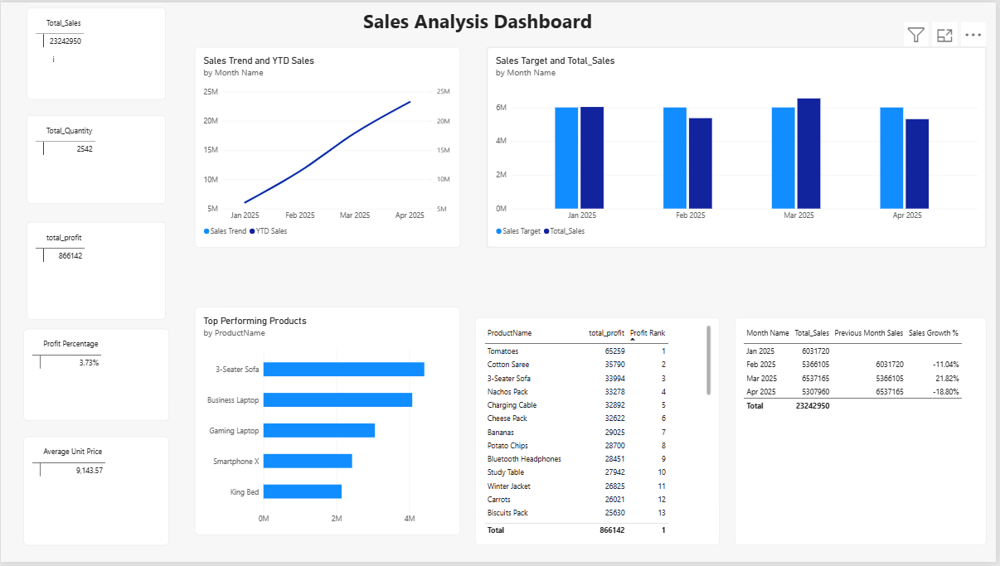

# Sales Performance Analysis Dashboard (Power BI & DAX)

An interactive Power BI dashboard that analyses sales performance using DAX measures for key business metrics, time-based trends, product rankings and actual-vs-target tracking.



## Overview

This project uses a practice sales dataset (200 transactions, 40 products, 4 regions, January to April 2025). The data is modelled as a star schema, and the dashboard answers questions such as:

- How much did we sell, and how profitable was it?
- How do sales change month over month, and what is the cumulative (YTD) trend?
- Which products perform best by sales and by profit?
- Are we meeting the sales target each month?

## Tools Used

- Power BI Desktop
- DAX (Data Analysis Expressions)
- Excel (source data)

## Data Model

| Table | Type | Key Columns |
|---|---|---|
| FactSales | Fact | SalesID, OrderDate, Region, ProductID, Quantity, UnitPrice, Sales, Profit |
| DimProduct | Dimension | ProductID, Category, SubCategory, ProductName, UnitPrice |
| Calendar | Date table | Date, Month Name, Month Num |

Relationships: `DimProduct[ProductID]` to `FactSales[ProductID]` and `Calendar[Date]` to `FactSales[OrderDate]`.

## DAX Measures (15)

**Core metrics:** Total_Sales, total_profit, Total_Quantity, Average Unit Price, Profit Percentage

**Time intelligence:** Sales Trend (cumulative), YTD Sales, Previous Month Sales, Sales Growth %

**Product ranking:** Sales Rank, Top Performing Products, Profit Rank

**Target tracking:** Sales Target, Target Variance, Target Achievement %

Examples:

```DAX
Total_Sales = SUM(FactSales[Sales])

Profit Percentage = DIVIDE([total_profit], [Total_Sales])

YTD Sales = TOTALYTD([Total_Sales], 'Calendar'[Date])

Previous Month Sales = CALCULATE([Total_Sales], PREVIOUSMONTH('Calendar'[Date]))

Sales Growth % = DIVIDE([Total_Sales] - [Previous Month Sales], [Previous Month Sales])

Profit Rank = RANKX(ALL(DimProduct[ProductName]), [total_profit], , DESC, Dense)
```

## Dashboard Contents

- KPI cards: Total Sales, Total Profit, Total Quantity, Average Unit Price, Profit %
- Line chart: Sales Trend and YTD Sales by month
- Clustered column chart: Sales Target vs actual Sales by month
- Bar chart: Top Performing Products
- Table: Products ranked by profit
- Table: Monthly sales, previous month sales and growth %

## Key Figures

- Total Sales: 23,242,950
- Total Profit: 866,142
- Total Quantity Sold: 2,542
- Average Unit Price: 9,143.57
- Profit Percentage: 3.73%

## Files

- `Sales Dataset.xlsx`: source data (FactSales and DimProduct sheets)
- `salesdata dax.pbix`: Power BI report (open with Power BI Desktop)
- `dashboard.png`: dashboard screenshot

## Note

The dataset is a practice dataset created for learning and is not real company data.
